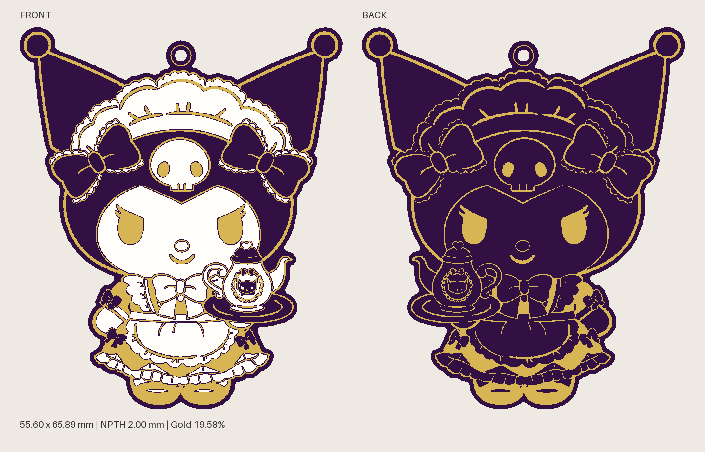
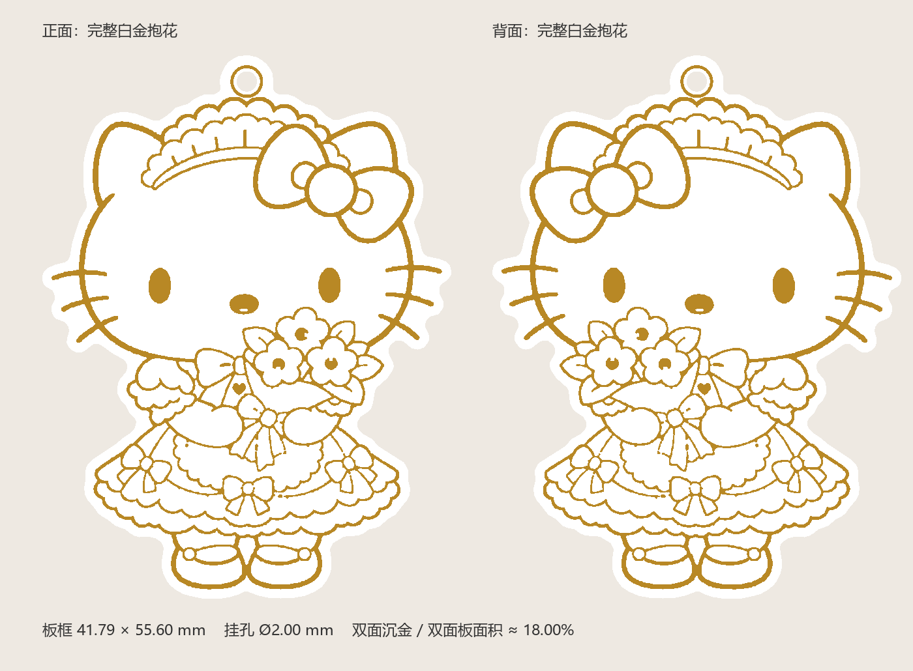
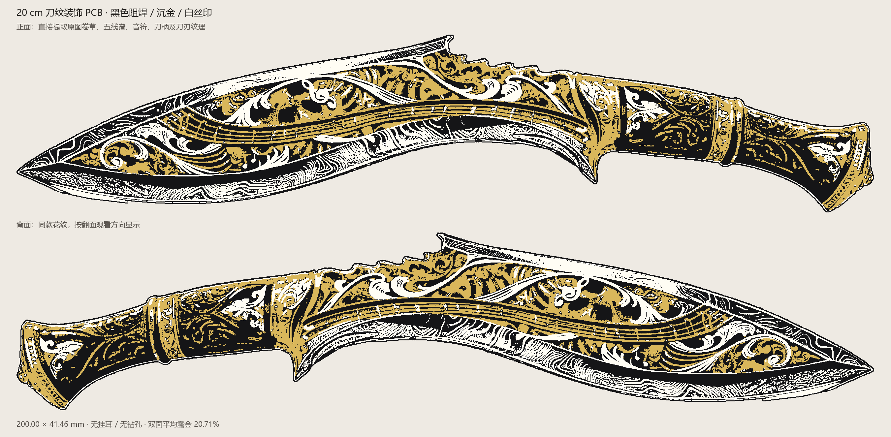
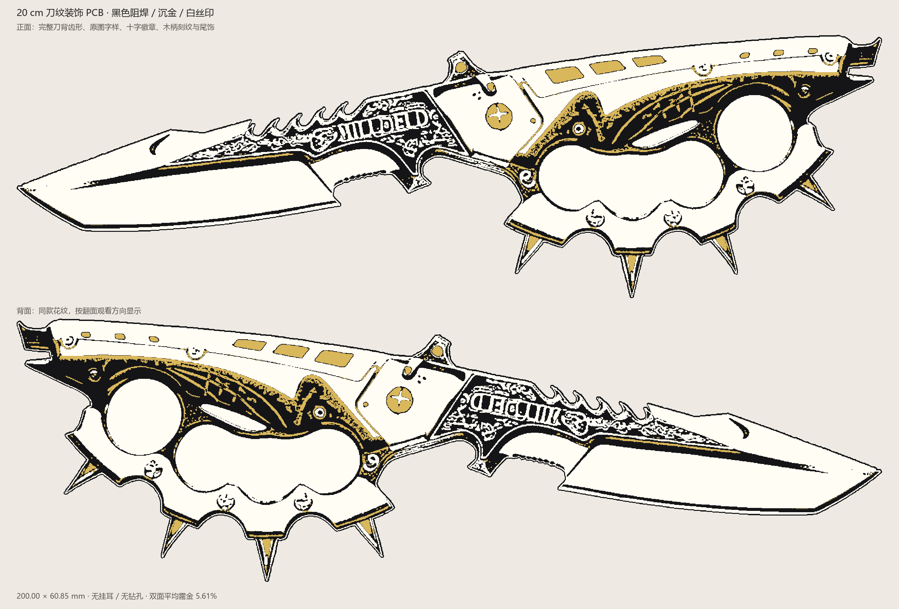

# PCB 图案挂件 · AI Skill

把参考图片制作成装饰 PCB：**AI 在本地完成分色、制造几何、检查和 JavaScript，用户在嘉立创 EDA 专业版运行脚本。**

默认无需 AI 操控浏览器，也无需提供 EDA 账号密码。完整 Skill、工具、模板、资料与复现案例都在下面的压缩包中，版本 **2.1.0**。

**[下载完整 Skill](https://github.com/xxhhwtxx/pcb-art-keychain-skill/raw/refs/heads/main/pcb-art-keychain-skill.zip)** · [详细使用说明](使用说明.md)

## v2.1.0 更新：沉金工艺要求

**金色预览不代表生产订单已经选择沉金。** 图案铜层与阻焊开窗只确定露铜位置，实际下单仍须在“焊盘喷镀/表面处理”明确选择“沉金 ENIG”；没有额外需要补画的“沉金层”。

- 生成设计时新增 `manufacturing_requirements.json` 和 `下单工艺要求.txt`，记录目标工艺、尺寸、板厚、阻焊色、丝印色及露铜面积。
- EDA 脚本完成提示会读取目标表面处理，并提醒核对实际订单；不将本地检查或金色预览报告为“已做沉金”。
- 新增实物无金色的排查指引：依次检查源图层、实际订单、提交的 Gerber 和生产稿。

已有正确 PCB 无需重画。更新下载包后，让 AI 阅读新的 `SKILL.md` 即可使用；原有图案几何和展示图保持不变。

## 设计展示

以下为已经完成设计的制造图形与工艺配色预览。

| 紫白金茶会挂件 | 白金抱花挂件 |
|---|---|
|  |  |

黑金白刀纹装饰板，同类脚本流程的定制扩展示例：





## 给其他 AI 使用

1. 下载并解压 `pcb-art-keychain-skill.zip`，保留完整的 `pcb-art-keychain` 文件夹。
2. 支持 Skills 的客户端：把这个文件夹放进该客户端的 Skills 目录；其他客户端：让 AI 读取 `pcb-art-keychain/SKILL.md` 及其引用资料。
3. 提供参考图片、尺寸、配色、挂孔和背面要求，让 AI 交付预览与完整 EDA 脚本。

AI 需要能读取本地文件并运行 Python。包内依赖可从 Skill 文件夹安装：

```sh
python -m pip install -r scripts/requirements.txt
```

可直接发送给 AI：

```text
请读取 pcb-art-keychain/SKILL.md，按脚本工作流把我的参考图做成装饰 PCB。
尺寸：[填写最大宽度和高度，单位mm，包含挂耳]。
配色：[填写阻焊色、沉金和丝印方案]。
挂孔与背面：[填写要求]。
请保留完整外轮廓、比例和细线，有毛刺时只做局部修复。
在本地生成制造几何、正反面工艺预览、检查报告和完整 EDA JavaScript。
我会在嘉立创 EDA 专业版手动运行脚本，无需控制浏览器。
请给出准确的导入、预览、保存步骤，并区分本地检查和实际 EDA 核验。
```

## 在 EDA 运行

1. 在嘉立创 EDA **专业版**中新建空白 PCB，打开图页。
2. 打开 **高级 → 运行脚本 → 导入**，选择 AI 生成的 `create_in_eda.js`。
3. 运行一次，等待结果提示；不要连续重复点击。
4. 打开2D/3D，执行导入更新，设置实际工艺配色并查看两面。
5. 核对 DRC 和保存状态，再从 EDA 导出工程及制板文件。
6. 查看随包下单工艺要求，在实际订单选择并核对“沉金 ENIG”。脚本、JSON与预览均不替订单选择工艺。

## Skill 包含什么

| 内容 | 文件 |
|---|---|
| 工作流与工程约束 | SKILL.md |
| 分色、共同坐标、工艺映射 | references/colour-separation.md |
| 本地生成参数与输出 | references/helpers.md |
| 局部去毛刺与补丁 | references/repair.md |
| EDA 导入、预览和保存 | references/eda-workflow.md |
| 沉金要求与实际订单、实物无金色排查 | references/manufacturing-finish.md |
| 面积核算与动态优惠核验 | references/free-pcb.md |
| EDA API 签名 | references/eda-api.md |
| 完整复现案例 | references/worked-example.md、assets/ |
| 几何生成、修复、补丁和 Gerber 工具 | scripts/ |

默认保护细线，不统一腐蚀或按面积删除小装饰。金色开窗下有铜，普通白丝印避让露金，正反面共享制造坐标。工具默认面向带挂孔挂件；无孔、内槽等其他板型需要 AI 按要求调整与核验。

随包记录了本地几何、脚本语法/API模拟和案例Gerber回读的检查范围。模拟检查不代表当前EDA版本已实际执行；工厂DFM、细纹实物效果和免费资格需要另外核验。

## English

A reusable AI skill for decorative PCB artwork. Generate manufacturing geometry, previews, local repairs and an EasyEDA Pro creation script locally, then run the script manually in EDA. Download the complete ZIP and ask your AI to read `pcb-art-keychain/SKILL.md`. The gallery shows manufacturing previews, including custom extensions of the same workflow.
